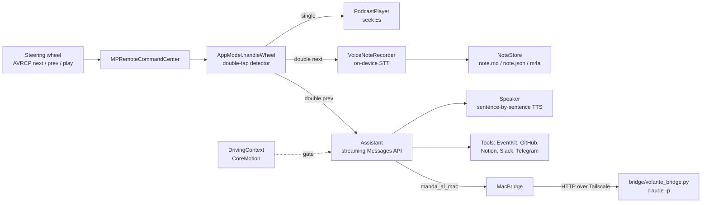

# Volante

A podcast player and voice-note recorder driven entirely from the steering-wheel
buttons, for cars **without CarPlay** — only Bluetooth A2DP/AVRCP. Built for a
2017 Nissan Micra. iOS 17+, SwiftUI, no third-party dependencies.

The UI, the spoken prompts and the assistant's system prompt are in Italian.

## Why

Without CarPlay, the only inputs you have while driving are play/pause, next and
previous. Volante turns those three buttons into a way to listen to podcasts and
capture ideas without touching the phone: a double tap records a voice note, and
the note remembers which episode you were listening to and at what minute.

## Steering-wheel gestures

| Button | Action |
|---|---|
| Play / Pause | play / pause |
| Next (single) | +30 s |
| **Next (double, < 450 ms)** | **voice note** |
| Previous (single) | −15 s |
| **Previous (double)** | **talk to Claude** (switchable to "voice note" in Diagnostics) |
| Any button while recording | stop and save |
| Any button while Claude is speaking | interrupt and reopen the mic |

- A rising beep means recording; the podcast pauses. A falling beep means the
  note is saved and the podcast resumes.
- Notes close by themselves after 2.5 s of silence (configurable).
- The head unit display shows the recording state through AVRCP metadata — the
  only visual feedback available without CarPlay.

All of these values (double-tap window, skip lengths, silence timeout) are in
`AppSettings.swift`.

## Notes

Transcription is on-device (`SFSpeechRecognizer` with `requiresOnDeviceRecognition`,
Italian by default). The audio is always kept, even if transcription fails. Files
are visible in the Files app under *On My iPhone → Volante*:

- `note.md` — every note as Markdown
- `note.json` — the same notes, structured, with episode GUID and position
- `NoteVocali/*.m4a` — the original audio

## Architecture



## Double tap and timestamp anchoring

Head units only send discrete `nextTrack` / `previousTrack` events, so a double tap
has to be reconstructed in software. Let $t_1, t_2$ be two presses of the same
button and $w$ the window (`doubleTapWindow`, default 450 ms):

- the first press is applied immediately as a normal skip of $\delta$ seconds
  (+30 / −15), so single presses feel instant;
- if $t_2 - t_1 < w$, the second press **undoes the first skip** ($-\delta$) and
  starts a note (or Claude) instead.

So the playback position at the moment the note starts is exactly the position
before the gesture. That value is frozen as the note's anchor:

$$
\text{anchor} = (\text{episode GUID},\ p_0), \qquad p_0 = \text{player.currentTime at note start}
$$

and stored with the episode's audio URL, so the anchor survives the episode
dropping out of the feed. Two things are derived from it later:

- **Replay from here** seeks to $\max(0,\ p_0 - 30\,\text{s})$: whatever prompted
  the note has just gone by.
- **Quote**: on demand, the window $[\max(0, p_0 - 45),\ \min(T, p_0)]$ of the
  downloaded episode (length $T$) is cut with `AVAudioFile` and transcribed
  on-device in the podcast's language, so a note can be read next to the words that
  triggered it.

## Loudness and the "don't talk now" gate

Episodes are measured with ITU-R BS.1770 (K-weighting: high shelf + RLB high-pass,
400 ms blocks, absolute gate at −70 LUFS and relative gate), sampling up to 20
windows across the file rather than decoding all of it. The applied gain is

$$
g = \operatorname{clamp}\left(-14 - L_{\text{int}},\ -12\ \text{dB},\ +15\ \text{dB}\right)
$$

applied to the player per episode (`PodcastPlayer`). The target matches the level of
system voice prompts, so interruptions do not jump out of the episode.

`DrivingContext` reads CoreMotion at 5 Hz. With gravity-free acceleration
$\lVert \mathbf{a} \rVert$ (in g) and rotation rate $\lVert \boldsymbol{\omega} \rVert$:

$$
\text{manoeuvre}(t) \iff \lVert \mathbf{a} \rVert > 0.22\,g \;\lor\; \lVert \boldsymbol{\omega} \rVert > 0.30\ \text{rad/s},
\qquad
\text{canInterrupt} \iff t - t_{\text{last manoeuvre}} > 4\ \text{s}
$$

Norms make it independent of how the phone sits in its mount; no location
permission is needed for this part.

## Talking to Claude

Optional; needs an Anthropic API key, entered in the app and stored in the
iOS Keychain (`Keychain.swift`), never in files or `UserDefaults`.

Replies are streamed from the Messages API and spoken sentence by sentence, so
speech starts before the full answer arrives. The default model is
`claude-haiku-4-5` (changeable in settings). The assistant knows the current
episode and minute and your recent notes. Tools (`AssistantTools.swift`,
`GitHubTools.swift`, `Integrations.swift`):

- calendar events, reminders, reading the agenda (EventKit)
- saving and searching voice notes, web search
- a small spoken contact log (`People.swift`) and messaging via WhatsApp
  (prepared, one tap to send), Telegram bot, Slack
- GitHub: repo status, code search, read a file, open an issue (needs a token)
- Notion: create and search pages (needs a token)
- `manda_al_mac`: hand a longer task to Claude Code on your Mac via the
  [bridge](bridge/README.md)
- spoken practice sessions: pitch, role-play, English (`Training.swift`)

Every tool is offered only if its token or URL is configured. After each action
the assistant reads back what it created, since the driver cannot check a screen.

Other pieces: loudness normalisation to −14 LUFS following ITU-R BS.1770
(`Loudness.swift`); a motion-based "don't talk during manoeuvres" gate
(`DrivingContext.swift`); an optional trip log with harsh-braking detection that
uses location and motion (`Trips.swift`); Siri / Shortcuts intents (`Intents.swift`).

## The audio session

The session is `.playAndRecord` from launch and never changes, with
`allowBluetoothA2DP`, no HFP, and the input pinned to the iPhone's built-in mic
(re-applied on every route change). Opening the mic would otherwise make the car
renegotiate Bluetooth from A2DP stereo down to HFP mono 8 kHz, and the podcast
would sound like a phone call for as long as the note lasts.

The **Diagnostics** tab shows the current route and a log of every button event,
so you can check in the car whether your head unit keeps A2DP while recording and
whether it delivers two distinct events for a double tap.

## Build

Requires [XcodeGen](https://github.com/yonaskolb/XcodeGen).

```sh
xcodegen generate
open Volante.xcodeproj
```

Set your own development team in Xcode (Signing & Capabilities), or add
`DEVELOPMENT_TEAM` to `project.yml`. Change `bundleIdPrefix` if you install it
on your own device. Then run on an iPhone.

## Limitations

- Tested on one car and one iPhone. Head units differ in how they report
  button presses; the double-tap window may need tuning.
- No automated tests.
- Italian-only UI and prompts.
- The bridge is designed for a private network (Tailscale); it has no TLS.

## License

MIT. See [LICENSE](LICENSE).
